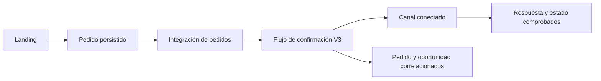

# Bots de ecommerce con plantilla V3

Guía de instalación, catálogo, conversación y validación de pedidos con **Ecommerce v3 Pro - LucidSales**. Está destinada a productos físicos. No sustituye un bot general de servicios, citas o reservas.

La guía explica qué configurar, qué comprobar y qué está pendiente de verificación en cada cuenta. No es una certificación de funcionamiento ni una copia de los videos del curso. La plantilla oficial referenciada es [Ecommerce v3 Pro, ficha 791284](https://panel.lucidbot.co/store/template.php?id=791284).

## Antes de empezar

| Dato necesario | Qué debe quedar decidido |
|---|---|
| Destino | Cuenta, tienda, bot, instalación existente y permisos autorizados |
| País y canal | País, moneda, zona horaria, número comercial, idioma y responsable del canal |
| Oferta | Productos, atributos, combinaciones permitidas, packs, precios y promociones autorizadas |
| Inventario | Fuente, fecha, unidades físicas, reservas y tratamiento de desconocido/agotado |
| Medios | Imágenes verificadas, relación con cada referencia y derechos de uso |
| Venta y entrega | Datos requeridos, cobertura, envío, pagos, cambios y garantías |
| Atención humana | Responsables, horario, asignación, avisos y devolución al bot |
| Landing | Sistema donde se crea el pedido, integración disponible y evento real que lo notifica |
| Prueba | Contacto y pedido de prueba controlados, límites de pago y despacho |

Recuperar esta información de los activos y la conversación existentes antes de pedirla otra vez. Nunca publicar claves, contactos, tablas de inventario ni identificadores privados en GitHub.

## Resultado buscado

Una compra de prueba debe dejar un pedido persistido con identidad y total correctos, entrar una sola vez al flujo V3 adecuado y producir una respuesta comprobada en el canal. La selección de producto y el pedido existente deben conservarse durante la conversación; una actualización no debe crear otra compra.



Este diagrama describe el recorrido a validar. Una flecha no equivale a una integración ya configurada.

## Cómo leer el estado

- **Documentado:** una fuente describe el procedimiento.
- **Configurado:** el cambio se guardó y se volvió a leer en la cuenta correcta.
- **Probado:** una entrada produjo el resultado esperado, comprobado en los objetos y el canal.
- **Activo:** la ruta está habilitada para su alcance de producción autorizado.

El estado se registra por función. Tener catálogo configurado y dos flujos activos no prueba que una compra de la landing llegue al bot.

Esta referencia distingue hechos observados de comprobaciones necesarias. Su evidencia y enlaces están en [evidence.md](../skills/lucid-sales-v3/references/evidence.md). La secuencia siguiente es una guía de implementación; no afirma que los controles de cada cuenta o versión sean idénticos.

## Instalación e identidad

- **Escrito en la ficha de instalación:** Store de Lucid Bot → Ecommerce v3 Pro → Install → seleccionar el bot → Install del destino. Para otro país, la ficha indica instalar primero V3 y después la adaptación de país sobre el mismo bot. Comprobar disponibilidad y compatibilidad actual antes de ejecutarlo.
- **Observado en una cuenta:** carpeta LucidSales (V3 Pro), versión visible V3-26.10.14 y flujos principales existentes. Este hallazgo demuestra que una instalación existente se debe inspeccionar, no reinstalar por defecto. No es la versión mínima exigida por esta skill.
- **Pendiente por cuenta:** tienda/bot exactos, permisos, canal y vinculación. Lucid Bot y Lucid Sales son productos distintos. Account ID, ID de bot, contacto, WABA y token tampoco se intercambian.
- La ficha de conexión Lucid Bot ↔ Lucid Sales describe el resultado, pero su copia escrita no contiene el formulario técnico. Inspeccionar la interfaz autorizada o el video correspondiente; no inventar un token, endpoint ni una secuencia de clics.

## Configuración comercial e IA

Completar empresa, descripción, dirección comercial, contacto y nombre del asistente. Configurar métodos reales de pago, políticas, preguntas frecuentes generales y postventa. En Lucid Sales → Lucid Bot → Modelo IA se documenta el acceso al comparativo y selección del modelo; comprobar información vigente, saldo y comportamiento efectivo antes de escoger. No reutilizar límites ni recomendaciones numéricas del curso.

Las reglas adicionales complementan a la plantilla. Antes de modificar contratos internos, localizar qué agente responde, qué herramientas tiene y qué flujos ejecutan. Separar generación de texto del envío y de la creación del pedido. Las funciones IA necesitan vínculo real al agente, parámetros y ruta de éxito/fallo.

Agrupar entradas y dividir salidas son ajustes diferentes. Probar una ráfaga producto/talla/ciudad, una corrección posterior y una conversación nueva para comprobar limpieza y conservación del contexto. Si se usa contenido dinámico, preservar acciones y campos al dividir el texto. La detección «contiene una llave» no valida JSON.

## Catálogo, packs y medios

Orden de revisión: catálogo existente → identidad por variante → precio/moneda → ofertas vendibles → proveedor/stock → medios → reglas conversacionales. No crear productos duplicados para remediar una coincidencia de nombre incompleta.

Separar atributos independientes: familia, material, diseño, color, talla y referencia. «Unicolor» no decide si una prenda es algodón o licra. La imagen permite proponer una referencia visible; la composición, el SKU, el precio y la existencia provienen de la ficha verificada.

Mantener una tabla privada con identificadores del origen y destino. Un producto comercial por pack puede representar varios componentes; no copiar su identificador como si fuera una referencia de una prenda. Si una unidad de inventario contiene tres pares, una oferta de seis pares consume dos unidades de esa referencia, cuando ese modelo de inventario esté confirmado.

### Semántica del precio

La revisión de fotogramas registra dos configuraciones históricas distintas:

| Interfaz del curso | Observación | Límite |
|---|---|---|
| Bundle de producto simple, 00:35 | Cantidad 2 y precio exterior 140.000 | No se observó un checkout guardado |
| Bundle de variantes, 02:20 y 02:49 | Cantidad 2, oferta nominal 120.000, precios de variantes 60.000 | Sustenta precio por componente en ese administrador; versión actual y redondeo por comprobar |

Por tanto, no ingresar el total de un pack en un campo unitario sin verificar cómo lo consume la versión actual. Comparar cantidad comercial, composición, precio persistido, total mostrado y total finalmente creado. Si dividir el total no produce un decimal admitido, documentar la discrepancia; no cambiar el precio comercial ni presentar un total aproximado como exacto.

Un SKU puede estar repetido entre bundles del mismo componente en una plataforma, pero el manifiesto local guarda cada componente una sola vez y lo referencia desde varias ofertas. [catalog-contract.md](../skills/lucid-sales-v3/references/catalog-contract.md) describe esa normalización; no implica que Lucid imponga unicidad global de SKU.

### Disponibilidad y fotografías

Separar `desconocida`, `verificada` y `asumida por política explícita`. No fabricar cantidades físicas. Permitir vender sin seguimiento de inventario no sincroniza almacenes. Verificar fecha, fuente, almacén y reserva antes de prometer stock comprobado.

Relacionar imagen de conjunto, individual y detalle con la referencia y material autorizados. Las imágenes generadas deben ser fieles y revisadas; no inventar textura, composición o diseño que el producto no tenga. Nombrar cada archivo de forma identificable, revisar recortes y texto alternativo y comprobar su presentación en el canal. Límites de galería se consultan en la interfaz actual; el límite observado en una cuenta no es universal.

## Canales, entrada y notificaciones

Inspeccionar Ajustes → Canales → WhatsApp en el bot destino. La ficha documenta Gestionar → Enlaces útiles → Plantilla de Mensaje; el alta del canal, requisitos de Meta y elegibilidad concreta deben verificarse en la cuenta. Conexión, entrada al Inbox, arranque del flujo y respuesta son comprobaciones separadas.

La creación histórica de plantillas también se accede desde el Administrador de WhatsApp. Elegir cuenta, nombre, idioma, categoría vigente, encabezado, cuerpo, ejemplos de variables y botones pertinentes. Consultar estado y sincronizar en Lucid si hace falta. No prometer plazo de aprobación ni usar categorías históricas como reglas actuales.

El cuerpo revisado de la lección «Mapeo de plantillas» solo contiene el título: su secuencia técnica está **pendiente de verificar**. En la implementación, observar el bloque correspondiente, vincular cada variable a campos existentes y enviar una prueba autorizada al destinatario controlado. Una muestra para aprobación no es el valor real del contacto. Un aviso de Inbox, una alerta de WhatsApp y un mensaje al cliente tienen destinos distintos.

## Pedidos y puente de landing

Flujos observados en una cuenta: `Flujo Principal - LucidSales` y `Confirmacion landing - LucidSales/Shopify/LandingPage`. También se observó una selección del flujo de confirmación en Lucid Sales. No copiar IDs de otro bot: resolver el flujo que realmente pertenece al destino.

La conexión Shopify mostraba estado conectado y opción Importar productos. La app estaba instalada, pero su panel incrustado no cargaba los controles. No se verificaron el interruptor de sincronización de pedidos ni el evento hacia V3. **Instalar, importar, leer pedidos y recibir un webhook son operaciones distintas.**

**Documentación oficial, no prueba de la cuenta:** abrir la app Lucid Bot en Shopify, entrar en Settings, sincronizar productos, introducir la clave del bot en el campo seguro, actualizar conexión/flujos, seleccionar el flujo, habilitar Sync Orders y guardar. El pedido necesita teléfono; Orders permite revisar resultado y reintento. [Guía oficial Shopify](https://ayuda.lucidbot.co/es/articles/9722085-como-conectar-lucid-bot-con-shopify-utilizando-la-aplicacion-lucid-bot). La [ficha de la app](https://apps.shopify.com/lucid-bot?locale=es) confirma transferencia de pedidos, ejecución de flujo y consulta de estado. La selección del flujo V3 correcto y su comportamiento se verifican en el destino.

Procedimiento de aceptación del puente, aún no una receta de endpoints:

1. Identificar dónde nace el pedido de la landing, su ID persistente y el total/estado real.
2. Observar la integración y evento soportados en esa versión. Registrar campos recibidos y errores sin exponer datos personales en el repositorio.
3. Mapear pedido, contacto, moneda, líneas, variante, cantidad de packs y composición. Diferenciar teléfono del canal de teléfono de entrega.
4. Resolver el flujo de confirmación y canal adecuados. Evitar crear otra orden cuando ya existe una del origen.
5. Correlacionar por tienda/origen/ID de pedido. Comprobar que la protección contra duplicados funciona también con eventos repetidos o concurrentes; una etiqueta o una lectura previa no demuestra exclusión mutua.
6. Ejecutar una compra controlada, verificar el pedido en origen, el evento, campos y oportunidad destino, la respuesta del bot y los importes. Mantener despacho/pago real dentro del alcance autorizado.
7. Repetir el mismo evento y una actualización del pedido. Verificar ausencia de pedido, cobro o mensaje duplicado no deseado.

Si faltan canal, landing o acceso al panel, entregar catálogo/configuración preparados y nombrar el puente pendiente. No sustituirlo por un enlace `wa.me` y llamarlo sincronización de compras.

## CRM, pago, garantías y humano

La ficha CRM describe áreas de leads, carritos, pedidos de chat/landing, logística, garantías, novedades y pagos. Sus automatismos son afirmaciones del curso hasta observar cada transición en el bot destino. Caliente no significa comprador; recuperar un carrito no se atribuye sin pedido/correlación comprobados.

Estados de control documentados: pendiente de confirmación, error al subir, corregido por subir y subido a Lucid Sales. En pagos: esperando comprobante, recibido y confirmado. Aplicar el estado según el hecho verificado. No reintentar una escritura incierta sin consultar si la orden ya existe.

Para garantías: identificar pedido/producto y motivo, guardar evidencia pertinente, abrir el caso y asignar responsable. El plazo y remedio salen de la política vigente del negocio, no de ejemplos de clase. La ficha muestra Garantía → En procesamiento → Resuelta, con gestión humana; no configurar aprobación automática porque una IA reconozca la palabra.

Transferir al humano, asignar asesor, detener seguimientos y enviar aviso son acciones diferentes. Probarlas y el retorno al bot. Después de la intervención humana, reconciliar datos estructurados y resumen pertinente para no recuperar una selección antigua.

## Integraciones opcionales

El texto de la lección Hoko observado documenta Ajustes → Tienda → Integraciones → Hoko → credenciales en su interfaz → Conectar; después Productos → Editar producto → Integración seleccionada → Hoko → Seleccione el producto. No demuestra mapeo por variante, dirección/frecuencia de stock ni envío automático. Usar solo si el usuario eligió Hoko y la correspondencia real es comprobable.

Otras integraciones presentes en el índice no se convierten en pasos conocidos por su título. Ads requiere vínculo real anuncio/producto; eventos de compra exigen un criterio de venta comprobado y deduplicación. No activar campañas o envíos por el solo hecho de configurar el catálogo.


## Conectar la compra Shopify con V3: receta oficial y comprobación

La documentación del proveedor describe esta secuencia histórica:

1. Abrir la app **Lucid Bot** instalada en Shopify y su apartado **Settings**.
2. Sincronizar los productos desde esa aplicación.
3. Introducir la clave API del bot destino en el campo seguro.
4. Pulsar **Connect to Lucid Bot & Refresh flows**.
5. Elegir el flujo que debe recibir el pedido; comprobar su identidad V3.
6. Habilitar **Sync Orders** y pulsar **Save**.
7. Comprobar teléfono del cliente y resultado en **Orders** antes de un reintento.

Fuente: [guía oficial del proveedor](https://ayuda.lucidbot.co/es/articles/9722085-como-conectar-lucid-bot-con-shopify-utilizando-la-aplicacion-lucid-bot). Contrastar nombres y disponibilidad en la interfaz actual.

La [ficha oficial de Shopify App Store](https://apps.shopify.com/lucid-bot?locale=es) describe envío de pedidos al bot, ejecución de un flujo de confirmación y consulta del resultado con posibilidad de reenvío. Es distinto de importar el catálogo desde Lucid Sales.

**Comprobación propia propuesta:** revisar los valores guardados, crear un pedido de prueba autorizado, anotar su ID de origen y verificar recepción, mapeo, flujo y mensaje. Repetir el evento y una modificación para comprobar deduplicación y actualización del mismo pedido. No marcar un pedido real como pagado sin pago verificado para imitar una demostración. No activar logística real como efecto secundario de la prueba.

Si el panel está en blanco, conservar la instalación y registrar el bloqueo: no afirmar que Sync Orders está habilitado ni reinstalar a ciegas. Si la landing usa otro sistema, esta receta no aplica automáticamente: identificar la integración oficial de ese origen y comprobar su contrato antes de describir endpoints o automatismos.


## Pruebas y cierre de la implementación

Cada fila empieza **pendiente**. Guardar por ejecución: entrada, resultado esperado, respuesta real, campos pertinentes, referencia del objeto comprobado, fecha/canal y resultado. Conservar los identificadores y datos personales en el registro privado del proyecto, nunca en el repositorio público.

| Caso | Comprobación que decide el resultado |
|---|---|
| Saludo nuevo y contacto existente | Una sola entrada al vendedor; contexto conservado cuando corresponde |
| Producto por nombre y cambio a otro | Catálogo/reglas/medios del producto nuevo; no arrastre de selección antigua |
| Algodón frente a licra; talla/color/referencia | Coincide la identidad estructurada; no deducción solo visual |
| Pack permitido y cantidad no ofrecida | Total y composición exactos; no venta individual si solo se ofrecen packs |
| Precio no divisible entre componentes | Total persistido y total del pedido coinciden; discrepancia registrada, sin redondeo supuesto |
| Upsell rechazado/aceptado | Rechazo no agrega línea; aceptación suma oferta/cantidad correctas |
| Agotado, desconocido y disponibilidad manual | Tres respuestas distintas; no presentar dato asumido como inventario en tiempo real |
| Imagen conocida y ambigua | Foto correcta; aclaración antes de asignar referencia incierta |
| Varios mensajes seguidos, pregunta y corrección | Agrupación no pierde cambio, no duplica salida, conserva datos confirmados |
| Dato de entrega incompleto | Pide solo faltante; no crea operación incompleta ni confirma envío |
| Pedido creado en landing | ID de origen correlacionado, flujo correcto, mensaje observado en destino |
| Mismo evento dos veces | No duplica pedido ni acciones comerciales; comprobar protección real |
| Timeout después de crear pedido | Consulta antes de reintentar; no trata incertidumbre como fallo definitivo |
| Comprobante de prueba recibido | Permanece pendiente hasta validación efectiva; no marca pagado por imagen |
| Petición de garantía | Caso ligado a pedido/producto y responsable; política real, sin aprobación inventada |
| Humano, baja y retorno al bot | Cambia atención/asignación, detiene rutas incompatibles, retoma datos actuales |
| Notificación interna | Llega al responsable correcto; cliente no recibe información interna |
| Error de IA/integración | Salida controlada; error no se interpreta como producto inexistente o stock cero |

## Ejemplo normal — diseñado, no ejecutado en Lucid

Una tienda ficticia vende una oferta de seis prendas de algodón por EUR 42.00. El cliente elige tres negras M y tres azules L dentro de esa oferta. La suma es seis; ambas variantes comparten material y diseño permitidos. Declina las medias. El resumen conserva producto, composición, total y entrega. Después de confirmación, se verifica una sola orden y se informa su estado real. El validador local incluye un ejemplo equivalente, pero no envía mensajes ni crea la orden.

## Ejemplo de error — reproducido localmente

Una oferta declara seis artículos a EUR 10.00 total y precio unitario EUR 1.67. El cálculo da EUR 10.02. El validador devuelve `pack_total_mismatch`; no lo corrige ni aprueba automáticamente. Para la cuenta real, revisar semántica y precisión del campo, corregir la configuración permitida y volver a probar el total del pedido. No modificar el precio autorizado solo para que la división cuadre.

## Formato de cierre

```text
Alcance y cuenta destino: registro privado
Plantilla y versión observadas:
Catálogo: diseñado / configurado / probado
Fuente de disponibilidad: verificada / desconocida / política manual explícita
Canal: no conectado / conectado / recepción y envío comprobados
Puente de pedidos: diseñado / configurado / probado
IA, humano, CRM y avisos: estado y evidencia por función
Casos ejecutados y fallidos:
Activación y alcance efectivo:
Pendiente concreto y siguiente acción:
```

No agrupar todo como «listo» si solo se guardaron los flujos. No enviar una compra de prueba a logística real ni marcar un pedido real pagado sin pago verificado para provocar un evento. Usar un entorno o pedido de prueba separado dentro de la autorización disponible.

## Herramienta local para auditar el catálogo

`scripts/validate_catalog.py` es una comprobación offline. **Este JSON no es un payload ni un importador de Lucid/Shopify/Hoko.** Los nombres siguientes son propios de esta herramienta, no campos nativos descubiertos en esas plataformas.

Ejemplo completo: [assets/catalog-fictional.json](../skills/lucid-sales-v3/assets/catalog-fictional.json). Todos sus datos, nombres, códigos, precios y cantidades son ficticios. No contiene contactos ni referencias externas reales.

## Estructura

| Campo | Tipo y significado |
|---|---|
| `schema_version` | Entero 1 |
| `currency` | Texto de tres letras mayúsculas; una moneda por manifiesto |
| `products` | Productos lógicos y sus componentes únicos |
| `product.id/name/item_unit` | Identidad propia, nombre y unidad física: por ejemplo prenda o par |
| `sell_mode` | `packs_only` o `units_and_packs`; es una decisión comercial de entrada |
| `allowed_quantities` | Cantidades de artículos permitidas por oferta; no obliga a crear todas las combinaciones |
| `variants` | `id`, `sku` como texto, `options` de texto, `inventory_unit_size`, `availability` |
| `inventory_unit_size` | Número de artículos físicos en una unidad indivisible del inventario de ese componente |
| `availability` | `unknown`, `verified`, `assumed`; el script no comprueba que la declaración sea cierta |
| `offers` | Ofertas comerciales: producto, variantes elegibles, cantidad por pack y precio |
| `allow_mixed` | Permite varias variantes en la misma composición |
| `same_options` | Atributos que deben coincidir entre las variantes elegidas, como material/diseño |
| `price_mode` | `pack_total` o `per_component`; describe el campo que se está auditando |
| `price_amount` | Decimal como cadena; precio del pack o del componente según el modo |
| `advertised_pack_total` | Total comercial autorizado de un pack, como cadena decimal |
| `upsells` | Producto de origen y oferta adicional existente; `optional: true` |
| `quotes` | Oferta, número de packs, variantes/cantidades físicas y total cotizado |

Una variante normalizada se guarda una vez; varias ofertas pueden referenciarla. Por eso duplicar su SKU en este manifiesto es un error. Esto no prohíbe que una plataforma repita una referencia dentro de administradores diferentes de bundles.

Si los precios dependen de la variante, dividir las ofertas/grupos de precio en el manifiesto. La versión 1 usa un precio uniforme por oferta; no representa reglas arbitrarias de precio mixto, envío, impuestos, descuentos acumulados ni multicurrency. Validar esos conceptos en el checkout real con su contrato específico.

## Cálculos

Para `per_component`: `price_amount × items_per_pack = advertised_pack_total`. Para `pack_total`: ambos importes deben coincidir. Se usa aritmética decimal exacta, sin tolerancia ni redondeo automático.

En una cotización: suma de cantidades seleccionadas = artículos por pack × número de packs. El total es precio por pack × número de packs. Si una referencia almacena tres pares indivisibles, la cantidad seleccionada debe ser múltiplo de tres. «Seis pares» no se convierte en «seis paquetes de tres pares».

## Ejecutar y entender el resultado

Desde la carpeta `skills/lucid-sales-v3` del repositorio:

```sh
python3 scripts/validate_catalog.py assets/catalog-fictional.json
python3 -m unittest discover -s scripts -p 'test_*.py'
```

Salida JSON: `ok`, `errors`, `warnings`, `counts`, `scope`. Códigos de proceso: 0 coherente, 1 errores de contenido, 2 archivo/JSON ilegible. El ejemplo coherente tiene 2 productos, 4 componentes y 5 ofertas; muestra avisos de stock no verificado porque sus existencias son desconocidas.

Errores como `pack_total_mismatch`, `composition_quantity`, `variant_wrong_product`, `incompatible_options` o `fractional_inventory_unit` identifican el desacuerdo concreto. Corregir los datos/autorización o el mapeo, no ocultar el error con un dato ficticio. Precio correcto en JSON no demuestra que se haya guardado igual en Lucid.

El validador no accede a internet, modifica archivos de entrada, valida titularidad de códigos, prueba fotos, ejecuta IA, confirma stock ni crea un pedido. Ejecutarlo con datos privados requiere conservar esos archivos fuera de la publicación pública.

### Ejemplo íntegro ficticio

```json
{
  "schema_version": 1,
  "data_kind": "fictional_example_not_for_import",
  "currency": "EUR",
  "products": [
    {
      "id": "demo-boxer",
      "name": "Bóxer de ejemplo",
      "item_unit": "prenda",
      "sell_mode": "packs_only",
      "allowed_quantities": [
        3,
        6,
        12
      ],
      "variants": [
        {
          "id": "demo-cotton-black-m",
          "sku": "DEMO-COT-NEG-M",
          "options": {
            "material": "algodón",
            "design": "unicolor",
            "color": "negro",
            "size": "M"
          },
          "inventory_unit_size": 1,
          "availability": "unknown"
        },
        {
          "id": "demo-cotton-blue-l",
          "sku": "DEMO-COT-AZU-L",
          "options": {
            "material": "algodón",
            "design": "unicolor",
            "color": "azul",
            "size": "L"
          },
          "inventory_unit_size": 1,
          "availability": "unknown"
        },
        {
          "id": "demo-lycra-black-m",
          "sku": "DEMO-LIC-NEG-M",
          "options": {
            "material": "licra",
            "design": "unicolor",
            "color": "negro",
            "size": "M"
          },
          "inventory_unit_size": 1,
          "availability": "unknown"
        }
      ]
    },
    {
      "id": "demo-socks",
      "name": "Medias de ejemplo",
      "item_unit": "par",
      "sell_mode": "packs_only",
      "allowed_quantities": [
        3,
        6
      ],
      "variants": [
        {
          "id": "demo-socks-black",
          "sku": "DEMO-MED-NEG-3P",
          "options": {
            "color": "negro",
            "size": "única"
          },
          "inventory_unit_size": 3,
          "availability": "unknown"
        }
      ]
    }
  ],
  "offers": [
    {
      "id": "demo-cotton-3",
      "product_id": "demo-boxer",
      "items_per_pack": 3,
      "item_unit": "prenda",
      "variant_ids": [
        "demo-cotton-black-m",
        "demo-cotton-blue-l"
      ],
      "allow_mixed": true,
      "same_options": [
        "material",
        "design"
      ],
      "price_mode": "per_component",
      "price_amount": "8.00",
      "advertised_pack_total": "24.00"
    },
    {
      "id": "demo-cotton-6",
      "product_id": "demo-boxer",
      "items_per_pack": 6,
      "item_unit": "prenda",
      "variant_ids": [
        "demo-cotton-black-m",
        "demo-cotton-blue-l"
      ],
      "allow_mixed": true,
      "same_options": [
        "material",
        "design"
      ],
      "price_mode": "per_component",
      "price_amount": "7.00",
      "advertised_pack_total": "42.00"
    },
    {
      "id": "demo-lycra-3",
      "product_id": "demo-boxer",
      "items_per_pack": 3,
      "item_unit": "prenda",
      "variant_ids": [
        "demo-lycra-black-m"
      ],
      "allow_mixed": false,
      "same_options": [],
      "price_mode": "pack_total",
      "price_amount": "27.00",
      "advertised_pack_total": "27.00"
    },
    {
      "id": "demo-socks-3",
      "product_id": "demo-socks",
      "items_per_pack": 3,
      "item_unit": "par",
      "variant_ids": [
        "demo-socks-black"
      ],
      "allow_mixed": false,
      "same_options": [],
      "price_mode": "pack_total",
      "price_amount": "12.00",
      "advertised_pack_total": "12.00"
    },
    {
      "id": "demo-socks-6",
      "product_id": "demo-socks",
      "items_per_pack": 6,
      "item_unit": "par",
      "variant_ids": [
        "demo-socks-black"
      ],
      "allow_mixed": false,
      "same_options": [],
      "price_mode": "pack_total",
      "price_amount": "21.00",
      "advertised_pack_total": "21.00"
    }
  ],
  "upsells": [
    {
      "source_product_id": "demo-boxer",
      "target_offer_id": "demo-socks-3",
      "optional": true
    }
  ],
  "quotes": [
    {
      "offer_id": "demo-cotton-6",
      "pack_count": 1,
      "selections": [
        {
          "variant_id": "demo-cotton-black-m",
          "quantity": 3
        },
        {
          "variant_id": "demo-cotton-blue-l",
          "quantity": 3
        }
      ],
      "quoted_total": "42.00"
    },
    {
      "offer_id": "demo-socks-6",
      "pack_count": 2,
      "selections": [
        {
          "variant_id": "demo-socks-black",
          "quantity": 12
        }
      ],
      "quoted_total": "42.00"
    }
  ]
}
```

## Fuentes y alcance del estudio

## Cobertura real del paquete

El material base Skool, «Plantilla de Ecommerce con LucidBot y Lucid Sales», tenía **74 lecciones en el índice** y **31 fichas escritas revisadas** en el registro consultado. Algunas fichas solo contienen su título; no acreditan un procedimiento. La revisión adicional de dos lecciones de bundles/variantes contrastó fotogramas seleccionados, no videos completos ni audio transcrito. Este paquete no afirma haber estudiado los 74 videos.

**Lucid Academy es otra formación:** 20 grabaciones estudiadas mediante transcripciones completas y pantallas seleccionadas según su registro consolidado. No es reproducción continua de todos los videos y no aumenta la cobertura de Skool. Los conceptos generales aplicados aquí proceden principalmente de clases 1–8 (datos, canal, flujos, secuencias, CRM, garantías), 9–11 (agentes, herramientas, visión y contexto), 13–18 (operaciones externas, validación, atención humana y errores).

Las observaciones de implementación usadas para detectar errores se han abstraído. No se incluyen identidades de tiendas/clientes, contactos, cantidades de stock, claves, capturas privadas, identificadores de bots/productos ni archivos del curso. Las cifras, productos y códigos del ejemplo ejecutable son ficticios.

## Cuatro niveles que no se deben mezclar

| Nivel | Qué permite afirmar | Qué no acredita |
|---|---|---|
| Documento del proveedor | El procedimiento o capacidad descritos por esa fuente | Vigencia exacta de todos los controles de una cuenta |
| Pantalla observada | El control, valor o estado visible en esa revisión | Resultado externo de guardarlo o activarlo |
| Inferencia | Una interpretación explícita que conecta evidencia | Comportamiento garantizado del sistema |
| Prueba funcional | Entrada, ejecución y lectura posterior observadas | Cobertura de otros canales, variantes o fallos no probados |

El ID **791284** es la ficha pública de la plantilla, no un ID de bot. La versión **V3-26.10.14** se observó en una cuenta; no es una garantía de versión actual ni requisito universal.

## Fuentes precisas

### Plantilla y configuración

- [Ficha oficial Ecommerce v3 Pro](https://panel.lucidbot.co/store/template.php?id=791284).
- [Instalación y adaptación de país](https://www.skool.com/lucidbot/classroom/2a2cc5ac?md=55f38d4ef4744ad1a1083fd7f808cd53): secuencia escrita de instalación.
- [Negocios a los que se dirige](https://www.skool.com/lucidbot/classroom/2a2cc5ac?md=c38d69337bea428c860f987a7e705059): productos físicos; las cifras/modelos citados son históricos y no se adoptan.
- [Registro Lucid Sales](https://panel.lucidsales.co/register).
- [Información general](https://www.skool.com/lucidbot/classroom/2a2cc5ac?md=55dc4555c24940afac7e266bad2f0691), [empresa y asistente](https://www.skool.com/lucidbot/classroom/2a2cc5ac?md=8ca75f0e5c374c60a609ca45efde8d05).
- [Conexión con Lucid Bot](https://www.skool.com/lucidbot/classroom/2a2cc5ac?md=7acbb60be85543bfa0155a8bcd459b51): finalidad documentada, formulario técnico no descrito en la ficha.
- [Modelo IA](https://www.skool.com/lucidbot/classroom/2a2cc5ac?md=b6d9b3f6185f4bfa90bc27a684ff7785), [agrupación](https://www.skool.com/lucidbot/classroom/2a2cc5ac?md=c7a11bfd54d64e0da79745b84bc697b4), [división de texto](https://www.skool.com/lucidbot/classroom/2a2cc5ac?md=efa96b0ee2234d488fe32eea378dda5d), [reglas adicionales](https://www.skool.com/lucidbot/classroom/2a2cc5ac?md=243c359422da428593982943e4e278b6).

### Catálogo y compra

- [Producto simple](https://www.skool.com/lucidbot/classroom/2a2cc5ac?md=807eb8bc9bac4400a3b3ec0d5655c2db): ficha, precio y medios.
- [Bundles](https://www.skool.com/lucidbot/classroom/2a2cc5ac?md=0a6a691b0dc1439ea54b8e84bcd4fcff): ficha escrita y fotograma 00:35 de un video de 01:41.
- [Variantes](https://www.skool.com/lucidbot/classroom/2a2cc5ac?md=2010bb264fa9476a9131008765f49bcd): ficha escrita y cuadros 01:38, 02:20, 02:49 de un video de 02:59. Precio por componente es una inferencia respaldada por cantidad/precios mostrados; total final/redondeo no se probaron allí.
- [Mensajes iniciales por producto](https://www.skool.com/lucidbot/classroom/2a2cc5ac?md=5e587c7d9352466fa5f9f6f11c1985f5), [reglas](https://www.skool.com/lucidbot/classroom/2a2cc5ac?md=25fda183c7694c90a5bbab1d53253e42), [preguntas frecuentes](https://www.skool.com/lucidbot/classroom/2a2cc5ac?md=0843ec178f704f41a16ff1fc75bd4e5b).
- [Shopify: documentación oficial](https://ayuda.lucidbot.co/es/articles/9722085-como-conectar-lucid-bot-con-shopify-utilizando-la-aplicacion-lucid-bot), publicada en 2024; contrastar controles actuales. El enlace fue aportado con lectura verificada durante esta preparación; el extractor de este paquete no pudo abrirlo. La [ficha oficial de la app](https://apps.shopify.com/lucid-bot?locale=es) sí se consultó directamente.
- [Hoko](https://www.skool.com/lucidbot/classroom/2a2cc5ac?md=eff72b8770fe4e75b95a1598eb5f77e9): pasos escritos revisados adicionalmente; no demostración de sincronización de variantes/stock.

### CRM, canal y postventa

- [CRM](https://www.skool.com/lucidbot/classroom/2a2cc5ac?md=6a7c0f9638274ff08031baf8c8990b90): áreas y estados descritos, no evidencia de que cada automatismo opere en cualquier cuenta.
- [Gestión de pedidos](https://www.skool.com/lucidbot/classroom/2a2cc5ac?md=34b2c75a81e34c1d8081fcc6cc9f4b88), [pagos](https://www.skool.com/lucidbot/classroom/2a2cc5ac?md=b4c358ad841d448f89ed0bdbb7ae59de), [políticas](https://www.skool.com/lucidbot/classroom/2a2cc5ac?md=52028d7477a048c2a7043c4cd25e081e), [postventa](https://www.skool.com/lucidbot/classroom/2a2cc5ac?md=a9cbca0efba4471d8c418d4a7aee0adb).
- [Notificaciones](https://www.skool.com/lucidbot/classroom/2a2cc5ac?md=a81c6b6dd6c241cfb15ac1c0a722375f), [plantillas WhatsApp](https://www.skool.com/lucidbot/classroom/2a2cc5ac?md=fd27e057b4c34dc9a4c6bfd5c599456e), [mapeo de plantillas](https://www.skool.com/lucidbot/classroom/2a2cc5ac?md=0a4849cc11a147aab6d8ba6c45e2f53f). La última ficha carece de instrucciones operativas en el registro.
- [Anuncios/productos](https://www.skool.com/lucidbot/classroom/2a2cc5ac?md=07390602db684de786f3dc4694fe10d6), [eventos de compra](https://www.skool.com/lucidbot/classroom/2a2cc5ac?md=ac0ba76237574f2cbf41e2699b305ab6): conexión descrita; evento y atribución reales requieren pruebas.

## Pendientes explícitos

Persisten como verificación por implementación: controles actuales de vinculación Bot/Sales y canal; mapeo técnico de plantillas; comportamiento vigente de redondeo; relación física de inventario/reservas; puente completo landing → pedido → V3 → mensaje; devoluciones/garantías y eventos de Ads de cada negocio. Los procedimientos diseñados en este paquete se prueban al ejecutarlos; redactarlos o validar un JSON local no los convierte en pruebas de producción.
